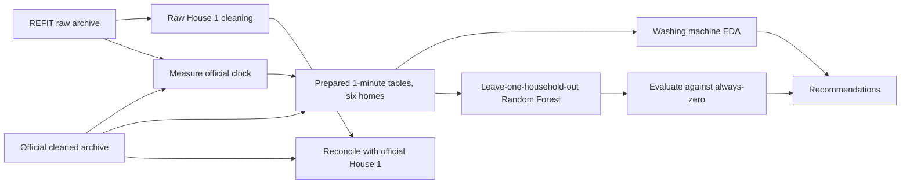
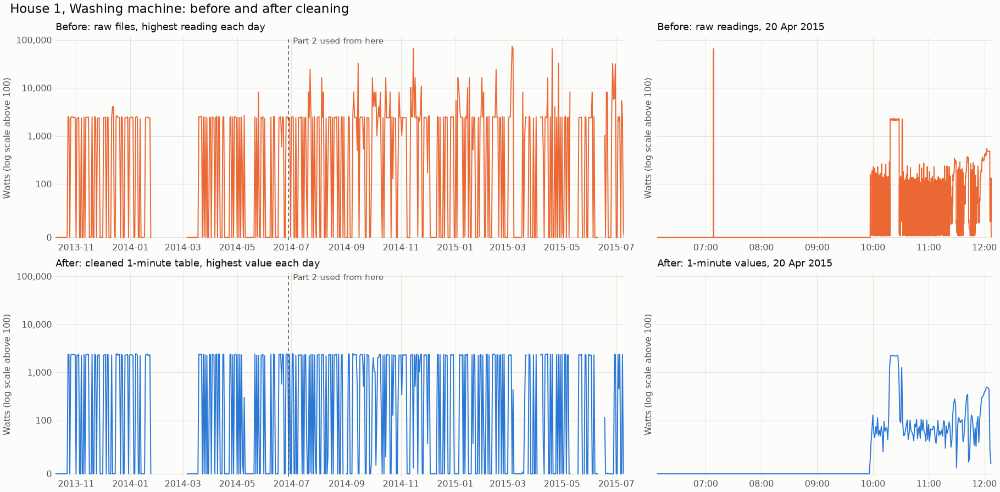
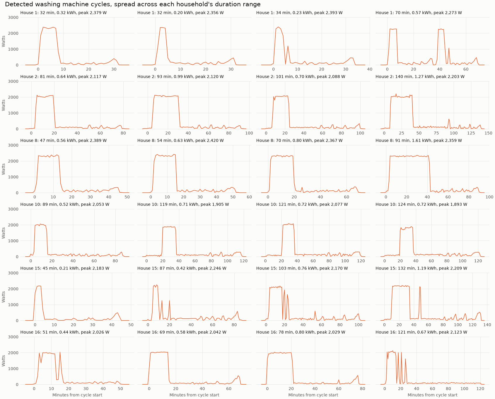
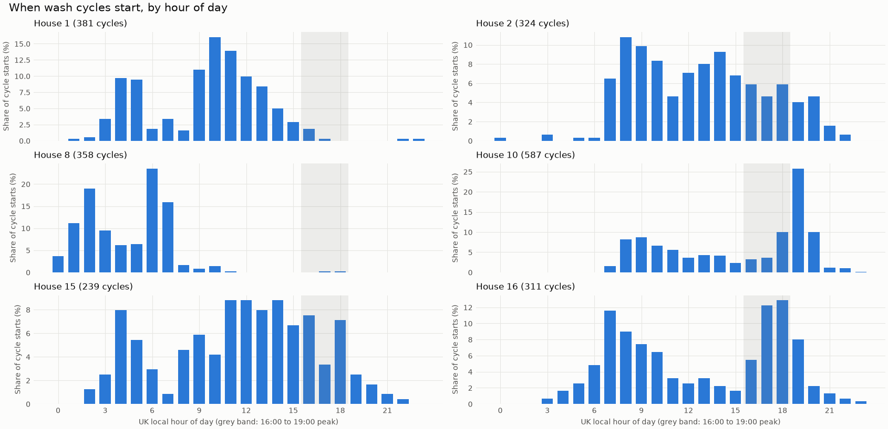
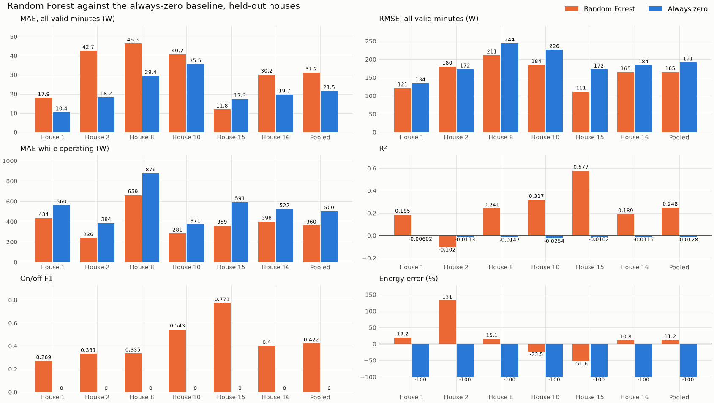
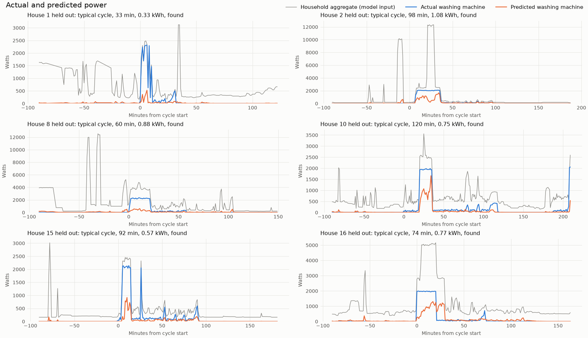
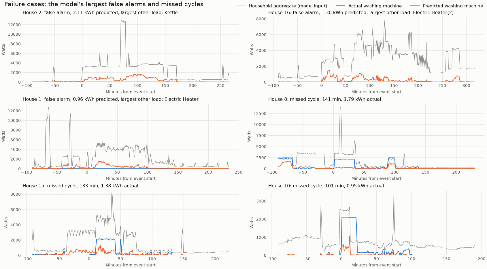

# REFIT Data Cleaning and Washing Machine Disaggregation

A data science take-home for Flock Energy. The project cleans raw household electricity logs from the REFIT dataset, analyses washing machine use across six UK homes, and tests whether a washing machine's power can be estimated from the whole-house meter alone, on homes the model has never seen.

**The short answer:** the model finds most washes, but it raises far more false alarms than correct detections, and it isn't accurate enough for decisions about an individual household.

| Part | Result |
|---|---|
| Raw cleaning | 8,518,763 raw House 1 rows become a 920,031-row, 1-minute table, with nothing filled or interpolated |
| Data audit | Raw timestamps are UK local time despite the documented "UCT", the official cleaned clock changes during the study, `Issues` depends on the target, and frozen sensors pass missing-value checks |
| Washing machine analysis | 2,239 cycles across six homes, at 3.5 to 8.8 cycles a week and 91 to 311 kWh a year. Heating is 70% to 90% of cycle energy |
| Disaggregation | On held-out homes, the model finds 90.6% of cycles at 26.1% precision. Its pooled MAE of 31.2 W loses to an always-zero baseline's 21.5 W, while RMSE (164.8 W against 191.2 W), R² (0.248 against -0.013) and error while the machine runs (360 W against 500 W) all beat it |
| Conclusion | Don't use this aggregate-only model to target or verify individual households. Measure a washing machine programme with plug meters |

> **Project status on 2026-11-05.** The cleaning, EDA, primary model and evaluation stages have been run, and every result below comes from their saved outputs unless stated otherwise. The `experiments`, `recommend`, `results` and `notebooks` stages are implemented but have no saved outputs. So [RESULTS.md](RESULTS.md) and [Recommendation.md](Recommendation.md) are still empty, `notebooks/` holds no notebooks, and no experiment results are reported here. [DATA.md](DATA.md) is complete and holds the full evidence for the cleaning decisions.

## Contents

1. [Problem statement](#problem-statement)
2. [Dataset](#dataset)
3. [Objectives](#objectives)
4. [Methodology](#methodology)
5. [Data-cleaning approach](#data-cleaning-approach)
6. [Washing machine EDA](#washing-machine-eda)
7. [Machine-learning approach](#machine-learning-approach)
8. [Evaluation metrics](#evaluation-metrics)
9. [Key findings](#key-findings)
10. [Limitations](#limitations)
11. [Practical recommendations](#practical-recommendations)
12. [Technology stack](#technology-stack)
13. [Project structure](#project-structure)
14. [Setup and execution](#setup-and-execution)
15. [Future improvements](#future-improvements)
16. [Data licence and citations](#data-licence-and-citations)

## Problem statement

A utility usually sees only a home's total electricity use. Knowing what one appliance is doing normally requires a separate sensor on that appliance. Non-intrusive load monitoring (NILM), also called disaggregation, tries to infer the appliance's use from the total instead.

Washing machines are a useful and difficult test case. Their heaters peak at about 2 kW in these homes, so they can stand out in the total. But a machine is active for only 1.85% to 9.57% of valid minutes, and other household loads produce similar steps. The data also has faults its documentation doesn't describe, so results can't be trusted until the data itself has been checked.

The project answers three questions:

1. Can raw sensor logs be made trustworthy at 1-minute resolution without inventing readings?
2. How do real households use their washing machines?
3. Can aggregate power alone recover washing machine use on an unseen home, well enough to act on?

## Dataset

[REFIT](https://doi.org/10.15129/31da3ece-f902-4e95-a093-e0a9536983c4) contains electrical load measurements from 20 households in the Loughborough area of the UK. Each home has 10 power sensors: a current clamp for the household aggregate and 9 individual appliance monitors. The readmes describe active power in watts at 8-second intervals, and give the study period as 2013 to 2014, although the data runs to July 2015.

| Release | Used for | Files | DOI |
|---|---|---|---|
| Raw | Cleaning House 1, and measuring the official clock | `REFIT_RAW_081116.7z`, `RAW_READ_ME_081116.txt` | [10.15129/31da3ece-f902-4e95-a093-e0a9536983c4](https://doi.org/10.15129/31da3ece-f902-4e95-a093-e0a9536983c4) |
| Official cleaned | EDA and modelling | `CLEAN_REFIT_081116.7z`, `CLEAN_READ_ME_081116.txt`, `MetaData_Tables.xlsx` | [10.15129/9ab14b0e-19ac-4279-938f-27f643078cec](https://doi.org/10.15129/9ab14b0e-19ac-4279-938f-27f643078cec) |

### Selected households

All 20 homes were screened on documentation, power signature, data volume, coverage, stability and how well the aggregate tracks the machine ([household_screening.csv](outputs/reports/household_screening.csv)). Each washing machine channel was checked against both readmes, the Excel metadata and the data itself.

| House | Machine channel | Occupants | Machine | Valid days | Main limitation |
|---|---|---|---|---|---|
| 1 | Appliance 5 | 2 | Beko WMC6140 | 557.7 | Weakest of the six: the sensors disagree on scale, and `Issues` flags 26.55% of rows with the machine at 500 W or more. Included because it links to the raw cleaning work |
| 2 | Appliance 2 | 4 | LG F1289TD | 461.9 | Most missing data, at 24.62% of minutes |
| 8 | Appliance 4 | 2 | Not documented | 494.2 | A washer-dryer is also in the aggregate |
| 10 | Appliance 5 | 4 | Beko WI1382 | 475.5 | Aggregate frozen for 45.8 days |
| 15 | Appliance 3 | 1 | Beko WMB91242LB | 486.0 | A tumble dryer is also in the aggregate |
| 16 | Appliance 5 | 6 | Bosch WAB24262GB/01 | 441.2 | Heaters and a dehumidifier are in the aggregate |

The other homes were left out for these reasons:

- **House 12:** no documented washing machine.
- **House 4:** two active machines.
- **House 11:** the aggregate barely registers its machine.
- **House 13:** an official change note on its channel.
- **Houses 3, 5, 6, 19 and 21:** the aggregate tracks the machine too poorly to model.
- **Houses 7, 9, 17, 18 and 20:** pass every check and are held in reserve.

Because the six were chosen on data quality, they aren't a random sample.

### Where the documents and the data disagree

| Documents say | The data shows |
|---|---|
| Timestamps are "UNIX TIMESTAMP (UCT)" | Raw `Time` and `Unix` are both UK local clock time |
| Cleaned files correct for daylight saving | Only for part of the study, and the offset differs by period and by house |
| Dataset page: gaps over 2 minutes were zeroed | Whole-house outages are missing rows, and in House 1 a silent washing machine sensor is held at its last value at any length |
| Sampled every 8 seconds | Raw House 1 Part 2 polls about 9 times a minute, but Part 1 only about 4, repeated across rows |
| Monitor spikes above 4000 W were removed | True, but bit errors below 4000 W survive, as do aggregate spikes up to 68 kW across houses |
| Study period 2013 to 2014 | Data runs to July 2015 |

## Objectives

| Objective | Status | Evidence |
|---|---|---|
| Clean raw House 1 at 1-minute resolution, documenting each decision | Done | [DATA.md](DATA.md), [cleaning_report.md](outputs/reports/cleaning_report.md) |
| Analyse washing machine use across at least four households | Done, with six | [outputs/reports/eda/](outputs/reports/eda/), [outputs/plots/eda/](outputs/plots/eda/) |
| Disaggregate the washing machine using official cleaned data | Done | [outputs/reports/model/](outputs/reports/model/) |
| Compare with a baseline, using leakage-free evaluation | Done | [metrics.csv](outputs/reports/model/metrics.csv), [test_features.py](tests/test_features.py), [test_metrics_training.py](tests/test_metrics_training.py) |
| Give practical recommendations and limitations | In this README. The generated `Recommendation.md` is pending | [Practical recommendations](#practical-recommendations) |

## Methodology



Five rules run through the work:

- **Inspect first.** Published cleaning rules and third-party values are treated as reference points. Each cleaning decision rests on evidence from the data.
- **Flag, don't fill.** No reading is forward-filled, zero-filled or interpolated. Suspect values stay in the tables with a flag, and each analysis decides what to exclude.
- **Leave originals alone.** Official files are read from the archive in memory and never changed, and original timestamps are kept.
- **Keep the two data roles apart.** The cleaned raw House 1 table is a cleaning deliverable, and it's compared against the official file as a check. EDA and modelling use the official cleaned files.
- **Evaluate on unseen homes.** Every model metric comes from a house that took no part in training or in choosing settings.

## Data-cleaning approach

The full reasoning and schemas are in [DATA.md](DATA.md), and the full figures are in [cleaning_report.md](outputs/reports/cleaning_report.md).

### Raw House 1

The input is two CSV files with the columns `Time, Unix, Aggregate, Appliance1..9`. The parts overlap in time and behave differently: Part 1 records an unavailable sensor as 0, while Part 2 records it as `NaN`.

| Step | Rows |
|---|---|
| Read from both parts | 8,518,763 |
| Part 1 rows not used, at or after the switch to Part 2 | -1,257,865 |
| Exact duplicates removed | -508,774 |
| Rows sharing a timestamp, averaged into one | -87,954 |
| **Unique timestamps** | **6,664,170** |
| **1-minute rows, including empty minutes** | **920,031** |
| Of which, minutes with at least one reading | 800,471 |

| Issue found | Decision | Effect |
|---|---|---|
| `Time` and `Unix` differ by 1 second in about half of rows | Use `Unix` as the key | Rows group under one consistent label |
| Raw clock is UK local, jumping back on 2013-10-27 and skipping the 01:00 hour in spring | Convert to UTC and keep the raw label | Continuous timeline, with no false outage in spring |
| Parts overlap | Part 1 before the first Part 2 timestamp, Part 2 from there, instead of a midnight cut | Keeps about 22 hours of good data a midnight cut would discard |
| Rows sharing a timestamp hold different readings, such as 3 W and 2,372 W | Average sensor by sensor, and never let a `NaN` erase a reading | 80,478 conflicts across 72,871 timestamps, all logged with their resolved value |
| Appliance readings above 4000 W, the monitors' rated limit, cluster on bit patterns such as 4096 and 8192 | Set to missing and count them. The official files use 0, which would claim the appliance was off | 2,622 readings removed, leaving 175 sensor-minutes empty |
| Aggregate readings above 23 kW, a threshold assumed from a 100 A supply at 230 V | Keep and flag them, because most look like a sensor ceiling during a large unmetered load | 63 readings across 24 minutes |
| Gaps and outages | Stay missing, with run lengths recorded | 82.99 days across 1,012 outages, the longest 41.6 days. 448 last 3 minutes or more and are flagged `long_outage` |
| Part 1 zeros can't separate "off" from "unavailable" | Keep them and record the source part | 310,522 minutes come from Part 1 |
| Autumn clock-change hours | Split by file order in 2013. Flag 2014, where the two passes are interleaved | 120 minutes flagged `dst_ambiguous` |
| Part 2 runs up to 7 minutes behind Part 1 in summer 2014, cause unproven | Flag it, don't correct it. The pipeline stops if measured drift falls outside the window | 79,200 minutes flagged `clock_uncertain` |
| A sensor repeats one exact 1-minute mean for 60 minutes or more (at 20 W or above for appliances) | Flag it and leave the values unchanged | On 8 February 2015 the machine held 2,256 W for 158 minutes, a false 5.94 kWh or 4.17% of its measured energy |

Each 1-minute value is the mean of the readings available in that minute, stored with a reading count and a missing flag. Minutes with no reading stay `NaN`.



**Check against the official file.** Agreement is close where both tables use the same raw part. The middle period is lower because of the clock drift between the parts.

| Period | Aggregate r | Washing machine r | Washing machine mean absolute difference |
|---|---|---|---|
| Both from Part 1, to 2014-06-27 | 0.9994 | 0.9996 | 0.14 W |
| This table from Part 2, official mostly from Part 1 | 0.7935 | 0.8037 | 3.99 W |
| Both from Part 2, from 2014-10-01 | 0.9992 | 0.9983 | 0.27 W |

### Official data for analysis and modelling

The `prepare` stage builds one 1-minute table per household, on a complete grid with nothing filled. Aggregate and appliance values come from the same rows, so they stay aligned.

| House | Minutes in span | Missing | Frozen, excluded | Valid minutes |
|---|---|---|---|---|
| 1 | 920,091 | 116,318 | 644 | 803,129 |
| 2 | 889,078 | 218,914 | 5,075 | 665,089 |
| 8 | 799,284 | 82,063 | 5,622 | 711,599 |
| 10 | 845,257 | 94,671 | 65,908 | 684,678 |
| 15 | 817,007 | 111,626 | 5,493 | 699,888 |
| 16 | 782,833 | 135,663 | 11,808 | 635,362 |
| **Total** | | | **94,550** | **4,199,745** |

Three decisions shape every later result:

**The official clock is measured, not assumed.** The official files shift by an hour at raw midnight on clock-change days and whenever their source part changes, so a blanket `Europe/London` conversion would be wrong. Each day's official aggregate is correlated with the raw aggregate at offsets of -60, 0 and +60 minutes.

- A day counts as `verified` if the best correlation is at least 0.9 and beats the next by at least 0.02, on at least 360 overlapping minutes.
- Of 3,173 household-days, 2,946 are `verified` and 115 are `inferred` from agreeing neighbours. These are used in hourly analysis.
- The other 48 `transition` and 64 `uncertain` days are left out of hourly analysis only.
- After correction, clock-change hours match raw in 18 of 19 household and date combinations with data.

The derived UK local time is used only for hour and weekday results. Modelling and cycle detection use the official row order.

**`Issues` rows stay in.** The documented rule reproduces the column on 100% of rows in all 20 houses, because `Issues` is simply "appliance sum above aggregate". It flags 0.24% to 5.84% of all rows, but 1.97% to 69.32% of rows with the machine at 500 W or more. So filtering on it selects on the target, and using it as a feature would leak appliance readings. Primary metrics include these rows, and secondary metrics exclude them.

**Frozen minutes are excluded.** Aggregate sensors freeze on one value for 0.07% to 8.78% of minutes per house. House 10 sits at exactly 2,169 W for about 31 days and 602 W for about 12 days with its machine reading zero, which a model would see as ordinary "no wash" time. These minutes stay flagged in the tables. For modelling they become `NaN` before features are calculated, so they can't enter the rolling windows of nearby minutes.

## Washing machine EDA

**Cycle definition** ([cycles.py](src/analysis/cycles.py)): power above 20 W, with off-gaps of up to 10 minutes bridged, lasting at least 20 minutes and peaking at 200 W or more. A minute at 1,000 W or more counts as heating, and a cycle needs at least 2 such minutes to count as heated. A missing minute is never treated as "off": it splits the run and marks the cycles beside it incomplete.

The detector captures 96.7% to 99.1% of machine energy. Across alternative settings, a house's cycle count changes by at most 9.4% ([parameter_sensitivity.csv](outputs/reports/eda/parameter_sensitivity.csv)). Of 2,239 cycles, 2,088 are complete, and medians use complete cycles only.

| House | Occupants | Cycles | Cycles a week | Median duration (min) | Median energy (kWh) | Heating share of energy | Machine kWh a year | Active minutes | Share of household energy |
|---|---|---|---|---|---|---|---|---|---|
| 1 | 2 | 384 | 4.82 | 33 | 0.320 | 77.7% | 91.0 | 1.85% | 2.18% |
| 2 | 4 | 337 | 5.11 | 98 | 0.633 | 79.7% | 159.7 | 4.72% | 3.96% |
| 8 | 2 | 364 | 5.16 | 60 | 0.799 | 89.9% | 257.3 | 3.33% | 4.27% |
| 10 | 4 | 598 | 8.80 | 120 | 0.716 | 70.0% | 311.3 | 9.57% | 5.25% |
| 15 | 1 | 244 | 3.51 | 92 | 0.729 | 79.5% | 151.4 | 2.92% | 6.78% |
| 16 | 6 | 312 | 4.95 | 74 | 0.632 | 84.5% | 172.6 | 3.76% | 3.53% |



**Heating dominates.** 97.0% to 100% of complete cycles are heated, and heating is 70% to 90% of cycle energy. The usual shape is a heating plateau of about 2 kW, then long low-power tumbling.

**Occupancy doesn't explain use in this sample.** The two-person House 8 uses more machine energy (257.3 kWh a year) than the six-person House 16 (172.6 kWh). Six homes can't support a firm conclusion on this.

**Timing differs sharply between homes.** Shares of cycle starts by UK local hour:

| House | Busiest start hour | 00:00 to 07:00 | 07:00 to 16:00 | 16:00 to 19:00 | 19:00 to 24:00 |
|---|---|---|---|---|---|
| 1 | 10:00 | 25.2% | 72.2% | 2.1% | 0.5% |
| 2 | 08:00 | 1.5% | 71.3% | 16.4% | 10.8% |
| 8 | 06:00 | 79.3% | 20.1% | 0.6% | 0.0% |
| 10 | 19:00 | 0.0% | 45.0% | 16.9% | 38.2% |
| 15 | 11:00 | 20.1% | 56.5% | 18.0% | 5.4% |
| 16 | 18:00 | 9.6% | 47.3% | 30.5% | 12.5% |



**Day of week shows no shared pattern.** Coverage-normalised rates are higher on weekdays than at weekends in five of the six homes (House 16 is the exception), and no single day is busiest across homes ([weekday_usage.csv](outputs/reports/eda/weekday_usage.csv)).

**Data handling changes the answers.** Without the clock correction, the start hour is wrong for 28.3% to 42.9% of cycles, and House 10's share of starts in 16:00 to 19:00 reads 26.1% instead of 16.9%. Frozen minutes barely change cycle counts, but House 10's machine energy reads 0.778 kWh a day with them and 0.853 kWh a day without, because its frozen stretches record a zero machine.

## Machine-learning approach

**Task:** predict washing machine watts for each minute from household aggregate power.

**Inputs:** 42 features built from one array of aggregate watts, all looking backwards ([features.py](src/models/features.py)). Appliance readings, `Issues`, household identity and time of day are never inputs.

| Feature family | Details | Count |
|---|---|---|
| Current reading | `aggregate` | 1 |
| Lags and changes | At 1, 2, 5, 15, 30 and 60 minutes | 12 |
| Rolling windows | Mean, standard deviation, minimum, maximum and height above minimum, over 5, 15, 30, 60 and 120 minutes | 25 |
| Event features | Large rises in 60 minutes, activity steps in 30 minutes, high-load minutes in 60 minutes, minutes since a heater-sized rise | 4 |

**Model:** scikit-learn `RandomForestRegressor` with 100 trees, a minimum leaf of 10 and `max_features=0.33`. It suits this setup because it needs no feature scaling, handles missing feature values natively, and fits each final forest in about a minute (53 to 70 seconds on a 10-core Apple M4). Hyperparameters are fixed, not tuned.

**Baseline:** always predict zero. The machine is off most of the time, so this is hard to beat on MAE, but it finds no cycles and reports no energy.

**Validation:** leave-one-household-out across the six homes. Each house is predicted by a model trained only on the other five, then scored on all its valid minutes. Each training house contributes up to 60,000 sampled minutes, giving 300,000 training rows per fold.

**Choices made on training houses only:** an inner leave-one-household-out on the five training houses, using smaller forests, chooses the sampling mix and the on/off threshold ([inner_selection.csv](outputs/reports/model/inner_selection.csv)). All six folds chose the natural mix and a 30 W threshold. Rebalancing towards operating minutes overestimated energy by 2.4 to 4.3 times, against 1.02 to 1.16 times for the natural mix.

**Determinism:** the seed is `42 + fold`, and predictions are rounded to 6 decimals to remove parallel floating-point noise.

### Leakage controls

| Risk | Control | Enforced by |
|---|---|---|
| Future readings | Trailing windows only. Changing later values must not change earlier features | `test_changing_the_future_never_changes_earlier_features` |
| Appliance readings, `Issues` or house identity reaching the model | `make_features` accepts one array of aggregate watts | `test_changing_appliance_issues_or_house_never_changes_features` |
| Held-out house in training | A fold refuses to run if the test house is in its training set | `test_fold_refuses_a_held_out_house_in_training` |
| Held-out house influencing settings | The outer test house isn't passed to selection | `test_selection_never_sees_the_held_out_house` |
| Frozen values entering nearby windows | They become `NaN` before features are made | `test_frozen_values_cannot_enter_neighbouring_windows` |

The tests above cover the code. Design choices are a different matter, as [Limitations](#limitations) explains.

### Implemented but not yet run

[experiments.py](src/models/experiments.py) defines four secondary experiments, and none of them replaces the primary result. They have no saved outputs, so this README reports no results for them.

- **Frozen minutes kept:** how much does the exclusion matter?
- **Retrospective features:** do future readings help after-the-fact analysis? These features are clearly labelled and would not be usable in real time.
- **Two-stage model:** a classifier, then a regressor. The rule for adopting it is fixed in code: pooled MAE must fall by at least 10%, with F1 no lower.
- **15-minute and 30-minute readings:** how does the method degrade at smart-meter resolution?

## Evaluation metrics

Definitions are in [metrics.py](src/models/metrics.py) and [evaluate.py](src/models/evaluate.py). A minute counts as "operating" when actual power is above 20 W, the same threshold as cycle detection.

| Metric | Definition | Why it's here |
|---|---|---|
| MAE and RMSE (W) | Per-minute error over all valid minutes | MAE rewards predicting zero, while RMSE penalises missing the 2 kW heater, so both are needed |
| R² | Against the mean of actual power | Scale-free comparison. Always-zero scores slightly below 0 |
| MAE while operating (W) | MAE on operating minutes only | Shows error when the machine is actually running |
| On/off precision, recall and F1 | Actual on is above 20 W. Predicted on is above the fold's threshold | Minute-level detection |
| Energy error (%) | (Predicted kWh - actual kWh) / actual kWh | Whether annual totals could be trusted |
| Cycle precision, recall and F1 | Actual and predicted cycles use the same gap and duration rules. A match needs overlap of at least half the shorter cycle, one-to-one | Detection of whole washes, which is closer to practical use |
| Household estimates | Annualised kWh, and the share of energy in 16:00 to 19:00 UK local | What a utility might actually use |

Metrics are reported per house, pooled across all held-out minutes, and as an unweighted mean across houses. Each is computed on all valid minutes (primary) and again excluding `Issues` = 1 (secondary).

## Key findings

The tables come from [outputs/reports/model/](outputs/reports/model/) and cover all valid minutes of homes the model didn't train on.

### 1. The model beats the baseline on some metrics, but not on MAE

Each cell shows Random Forest / always-zero.

| House | Valid minutes | MAE (W) | RMSE (W) | R² | MAE while operating (W) |
|---|---|---|---|---|---|
| 1 | 803,129 | 17.9 / 10.4 | 120.8 / 134.2 | 0.185 / -0.006 | 434 / 560 |
| 2 | 665,089 | 42.7 / 18.2 | 180.0 / 172.5 | -0.102 / -0.011 | 236 / 384 |
| 8 | 711,599 | 46.5 / 29.4 | 210.8 / 243.7 | 0.241 / -0.015 | 659 / 876 |
| 10 | 684,678 | 40.7 / 35.5 | 184.2 / 225.7 | 0.317 / -0.025 | 281 / 371 |
| 15 | 699,888 | 11.8 / 17.3 | 111.3 / 172.1 | 0.577 / -0.010 | 359 / 591 |
| 16 | 635,362 | 30.2 / 19.7 | 164.6 / 183.7 | 0.189 / -0.012 | 398 / 522 |
| **Pooled** | **4,199,745** | **31.2 / 21.5** | **164.8 / 191.2** | **0.248 / -0.013** | **360 / 500** |

- **MAE:** the model beats always-zero only in House 15.
- **RMSE and R²:** it beats always-zero in five of six homes, and loses in House 2.
- **MAE while operating:** it beats always-zero in all six.



### 2. It finds most washes, but with many false alarms

| House | Minute precision | Minute recall | Minute F1 | Actual cycles | Predicted cycles | Matched | Cycle precision | Cycle recall | Cycle F1 | Energy error |
|---|---|---|---|---|---|---|---|---|---|---|
| 1 | 0.173 | 0.610 | 0.269 | 384 | 1,266 | 282 | 0.223 | 0.734 | 0.342 | +19.2% |
| 2 | 0.231 | 0.585 | 0.331 | 337 | 1,429 | 313 | 0.219 | 0.929 | 0.354 | +131.5% |
| 8 | 0.204 | 0.937 | 0.335 | 364 | 2,074 | 356 | 0.172 | 0.978 | 0.292 | +15.1% |
| 10 | 0.470 | 0.644 | 0.543 | 598 | 1,550 | 572 | 0.369 | 0.957 | 0.533 | -23.5% |
| 15 | 0.755 | 0.788 | 0.771 | 244 | 275 | 218 | 0.793 | 0.893 | 0.840 | -51.6% |
| 16 | 0.278 | 0.711 | 0.400 | 312 | 1,168 | 288 | 0.247 | 0.923 | 0.389 | +10.8% |
| **Pooled** | **0.303** | **0.695** | **0.422** | **2,239** | **7,762** | **2,029** | **0.261** | **0.906** | **0.406** | **+11.2%** |

The pooled energy error of +11.2% is misleading on its own, because large errors of opposite sign cancel: individual homes range from -51.6% to +131.5%. The model predicts about 3.5 times as many cycles as really happen.

Recall depends on the heater, which is the main signal the model finds ([cycle_recall_by_type.csv](outputs/reports/model/cycle_recall_by_type.csv)):

| Cycle type | Cycles | Recall |
|---|---|---|
| Heated | 2,154 | 91.8% |
| Unheated | 85 | 61.2% |
| Under 5 heating minutes | 168 | 61.9% |
| 15 or more heating minutes | 1,150 | 97.4% |
| Under 45 minutes long | 440 | 70.9% |
| 90 minutes or longer | 988 | 97.9% |



### 3. The error pattern points to ambiguity in the signal

The evidence below is consistent with this explanation, though it doesn't prove it. The experiments that test it directly haven't been run.

- **Half the error is false load.** 50.6% of absolute error comes from minutes when the machine is off, and 7.17% of off minutes are predicted on ([error_sources.csv](outputs/reports/model/error_sources.csv)).
- **The model hedges.** While the machine is operating, predictions average 189 W against a true 500 W. The forest averages over look-alike situations, so it rarely commits to the full heater power.
- **High household load is ambiguous.** Below 500 W of aggregate, the machine is active 1.6% of the time. At 1,500 W or more, it's active only about a fifth of the time, so a high reading alone says little ([error_by_aggregate_level.csv](outputs/reports/model/error_by_aggregate_level.csv)).
- **False alarms overlap with other loads.** In House 2, a dishwasher is the strongest metered load during 53.8% of false-alarm energy, and in House 15 it's a tumble dryer at 51.2%. In House 8, 85.9% falls when no metered appliance is at 100 W or more, which points to unmetered load ([false_alarm_sources.csv](outputs/reports/model/false_alarm_sources.csv)).
- **Thresholding doesn't fix it.** Setting predictions below the threshold to zero only moves pooled MAE from 31.2 W to 29.9 W.
- **Performance varies by home.** House 15 does best (cycle F1 0.840) and has the lowest household consumption, at 6.12 kWh a day. House 8 does worst (cycle F1 0.292).

The most important features by impurity are `min_5m`, `above_min_60m`, `above_min_120m`, `aggregate`, `above_min_30m` and `std_5m` ([feature_importance.csv](outputs/reports/model/feature_importance.csv)). Most describe a recent floor or the height above it, in line with the model looking for a step. Impurity importance is only a rough guide when features are this correlated.



In the three largest false alarms, the aggregate sits at a median of about 3.3 kW to 3.6 kW for over two hours with the machine fully off. Two of the three largest misses, in Houses 8 and 15, ran beside other load of about 1.0 kW and 2.7 kW during heating. House 10's ran beside only about 360 W, so competing load doesn't explain every miss.

### 4. Household-level estimates aren't reliable

| House | Actual kWh a year | Predicted kWh a year | Actual share in 16:00 to 19:00 | Predicted share in 16:00 to 19:00 |
|---|---|---|---|---|
| 1 | 91.0 | 108.5 | 2.2% | 12.6% |
| 2 | 159.7 | 369.6 | 17.6% | 23.8% |
| 8 | 257.3 | 296.2 | 0.5% | 7.9% |
| 10 | 311.3 | 238.2 | 10.3% | 23.4% |
| 15 | 151.4 | 73.3 | 21.5% | 24.2% |
| 16 | 172.6 | 191.2 | 29.1% | 24.2% |

The model doesn't rank homes well: House 2 is predicted highest but is fourth in reality. It also overstates evening use for homes that wash overnight or in the morning, such as Houses 1 and 8.

### 5. Filtering on `Issues` would distort the results

Excluding `Issues` = 1 removes 1.76% of all minutes but 16.99% of operating minutes. In House 1 it removes 55.9% of the machine's measured energy, which moves that home's energy error from +19.2% to +139.5%.

| Pooled metric | All valid minutes | Excluding `Issues` = 1 |
|---|---|---|
| Random Forest MAE | 31.2 W | 28.5 W |
| Always-zero MAE | 21.5 W | 17.9 W |
| MAE while operating | 360 W | 354 W |
| On/off F1 | 0.422 | 0.394 |
| Energy error | +11.2% | +26.7% |

The lower MAE after filtering comes largely from removing machine activity, not from a better model, so the all-minutes figures stay primary.

## Limitations

**Sample and validation**

- **Small, selected sample.** Six homes near Loughborough in 2013 to 2015, chosen on data quality. Weaker homes would probably score lower, and findings about occupancy or habits can't be generalised.
- **No untouched test set.** Folds are clean, but the household choice, cycle thresholds and feature constants, such as the 1,500 W heater rise, were set with knowledge of this data. Houses 7, 9, 17, 18 and 20 pass screening and remain unused.
- **No test over future periods.** Leave-one-household-out tests new homes, not later time. Training and test homes overlap in calendar time, and drift isn't measured.
- **No uncertainty estimates.** Results are point estimates over six folds, without confidence intervals.
- **Lenient cycle matching.** Overlap is measured against the shorter cycle, so a long predicted block can match a short wash. Cycle recall should be read as an upper-end figure.

**Labels and data**

- **Sub-meter readings aren't perfect ground truth.** In House 1 the aggregate rises only 0.85 W per 1 W of washing machine at heating edges, and the sensors' total exceeds the aggregate in 19.4% of heating minutes. The readmes warn that occupants may have moved or swapped appliances.
- **Off and unavailable can be confused.** Part 1 zeros can't be separated, and a held value of zero can't be told apart from an idle machine.
- **Faults may remain.** Frozen runs under 60 minutes aren't flagged. Bit errors below 4000 W aren't removed, and aggregate spikes remain flagged, not corrected.
- **Clock uncertainty.** Hourly results rest on measured offsets and leave out transition and uncertain days. The cause of the Part 2 drift is unproven.
- **Primary paper not read.** The *Scientific Data* paper could not be accessed. Everything rests on the readmes, the metadata and the data.

**Method**

- **1-minute means.** Short motor patterns visible at higher resolution aren't used, and the forest sees sequence only through hand-built features.
- **Cycle detection.** Back-to-back washes can merge, and 11 detected events exceed 240 minutes.
- **The 16:00 to 19:00 window** is a project constant, not a measured or tariff-based peak.
- **Savings are scenarios.** The data doesn't record wash temperature or load size, so the scenarios below can't separate programme choice from load.

**Project state**

- **Secondary stages have no saved outputs.** See the [stage table](#pipeline-stages).
- **One test fails.** See [Tests](#tests).

## Practical recommendations

These follow from the saved results. The savings and sample-size figures in recommendations 2 and 3 were computed for this README by running `opportunity_table` and `measurement_power` from [savings.py](src/analysis/savings.py) on the saved EDA tables. The `recommend` stage that would save them hasn't run, so no output file holds them yet. Treat them as rough sizing from six homes, not forecasts.

**1. Don't use the aggregate-only model for decisions about one household.**

| Possible use | Evidence | Verdict |
|---|---|---|
| Real-time power per minute | Pooled MAE 31.2 W, worse than always-zero | No |
| Annual energy per home | Error from -51.6% to +131.5% | No |
| Finding evening users | Overstates evening use: House 8 is 0.5% actual and 7.9% predicted | No |
| Counting washes per home | 90.6% recall, 26.1% precision | No |
| Energy totals across many homes | Pooled error +11.2%, but from six homes with offsetting errors | Only after wider validation |

**2. If acting on washing, focus on heating rather than timing.** Heating is 70% to 90% of cycle energy, and homes vary widely in how much they use per cycle, so a prompt towards cooler washes is the natural idea to test.

- **Sizing:** capping heating energy above each home's own median saves a mean of 29.0 kWh a year, ranging from 12.0 to 66.8 kWh. That's 15.2% of machine energy but only 0.64% of household use. Capping at each home's lower quartile gives 48.6 kWh.
- **Assumptions:** this assumes every above-median cycle changes, so real uptake would be lower. It doesn't assess cleaning results or rewashing.
- **Timing:** moving washes out of the evening looks smaller. Mean machine power in 16:00 to 19:00 is 1.1 W to 45.5 W per home, averaging about 22 W.

**3. Measure any programme at the machine, not the whole-house meter.** The same saving is 15.22% of mean machine energy but 0.64% of mean household energy.

| Measured at | Homes per arm | Homes per arm if pre-trial use explains 70% of variance |
|---|---|---|
| Plug meter on the machine | 119 | 36 |
| Whole-house smart meter | 37,286 | 11,186 |

These use 5% significance and 80% power, with variation estimated from only six homes, and the 70% figure is an assumption to confirm. A randomised panel of about 150 homes per arm, with plug meters, would leave room for dropout. The cycle detector in this project can process that data directly, because it works on measured machine power.

**4. Gate data quality before any modelling.** Check for frozen sensors, measure clock offsets instead of assuming them, and don't filter on `Issues` without checking what it removes. Each of these changed a result here, as the [cleaning](#data-cleaning-approach) and [EDA](#washing-machine-eda) sections show.

**5. Validate before any deployment.** A utility would need many more plug-metered homes covering different machines and electric heating. It would also need to report results at the level the evidence supports, and monitor for drift.

**6. Don't assume half-hourly data will do better.** The signal the model relies on is a short step, which averaging should weaken. That is a hypothesis until the implemented 15-minute and 30-minute experiment has been run.

**7. Treat appliance-level insight as personal data.** Even these simple patterns reveal routines. House 8, for example, starts 79.3% of its washes before 07:00. Consent and data access rules need separate review.

## Technology stack

| Purpose | Tools |
|---|---|
| Language | Python 3.14.4 |
| Data | pandas 3.1.1, NumPy 2.5.4, PyArrow 26.0.1 (Parquet with zstd compression) |
| Reading sources | py7zr 1.1.4 (streaming from the archives), openpyxl 3.1.5 (Excel metadata) |
| Modelling | scikit-learn 1.9.1, joblib 1.6.0 |
| Plots | matplotlib 3.11.2, seaborn 0.13.2 |
| Notebooks | Jupyter 1.1.1, notebook 7.6.4, ipykernel 7.4.0, nbclient 0.11.0, nbformat 5.11.1, nbconvert 7.17.2 |
| Testing | pytest 9.2.0 |

All versions are pinned in [requirements.txt](requirements.txt). SciPy 1.18.1 is also pinned, but the project doesn't import it directly.

## Project structure

```text
flock-energy-nilm/
├── README.md                  This file
├── DATA.md                    Sources, cleaning decisions and evidence
├── RESULTS.md                 Generated by the results stage. Empty for now
├── Recommendation.md          Generated by the results stage. Empty for now
├── requirements.txt           Exact dependency versions
├── pyproject.toml             pytest configuration
├── src/
│   ├── pipeline.py            Command line entry point and all 16 stages
│   ├── config.py              Paths, checksums, households and thresholds
│   ├── io_utils.py            Reading files and streaming from archives
│   ├── reporting.py           Writes RESULTS.md and Recommendation.md from saved outputs
│   ├── build_notebooks.py     Writes and executes the four notebooks
│   ├── notebook_helpers.py    Display helpers for the notebooks
│   ├── cleaning/              Checksums, screening, raw checks, House 1 cleaning, clock,
│   │                          official-data preparation, reconciliation and reports
│   ├── analysis/              Cycle detection, usage analysis, savings scenarios, plots
│   └── models/                Features, dataset, training, baseline, metrics, evaluation,
│                              experiments, plots
├── tests/                     pytest suite, one file per area
├── outputs/
│   ├── reports/               Saved tables and reports (tracked in git)
│   │   ├── eda/
│   │   └── model/
│   ├── plots/                 Saved figures (tracked in git)
│   │   ├── cleaning/
│   │   ├── eda/
│   │   └── model/
│   └── models/                Fitted forests and held-out predictions (not in git)
├── data/                      Not in git
│   ├── raw/archives/          Downloaded archives, never modified
│   ├── raw/docs/              Readmes and metadata
│   ├── raw/refit_raw/         The two raw House 1 CSVs, extracted by acquire
│   └── cleaned/               Parquet tables written by clean and prepare
└── notebooks/                 Created by the notebooks stage. Empty for now
```

## Setup and execution

### Prerequisites

- Python 3.14.4. Measurements below were taken on macOS 15.5 with an Apple M4 (10 cores) and 16 GB of memory. Other platforms are untested.
- About 2 GB of free disk space for the data and outputs, plus about 750 MB for the virtual environment. The pipeline never unpacks the archives in full, because they expand to 8.31 GB and 6.94 GB.

### Install

```bash
python -m venv venv
source venv/bin/activate
pip install -r requirements.txt
```

### Get the data

The University of Strathclyde's file links need a normal browser, so download these five files by hand from the [raw](https://pureportal.strath.ac.uk/en/datasets/refit-electrical-load-measurements/) and [cleaned](https://pureportal.strath.ac.uk/en/datasets/refit-electrical-load-measurements-cleaned/) dataset pages:

| File | Size | Put it in |
|---|---|---|
| `REFIT_RAW_081116.7z` | 666 MB | `data/raw/archives/` |
| `CLEAN_REFIT_081116.7z` | 490 MB | `data/raw/archives/` |
| `RAW_READ_ME_081116.txt` | 10.8 KB | `data/raw/docs/` |
| `CLEAN_READ_ME_081116.txt` | 11.7 KB | `data/raw/docs/` |
| `MetaData_Tables.xlsx` | 28.5 KB | `data/raw/docs/` |

The `acquire` stage stops if any file differs from the SHA-256 recorded in [config.py](src/config.py).

### Run

Each stage reads only files on disk, and if an input is missing it names the stage to run first.

```bash
# One stage at a time, from the project root
python -m src.pipeline --stage acquire
python -m src.pipeline --stage clean

# Every stage in order, including the four that have no saved outputs yet
python -m src.pipeline
```

To reproduce the verified results, run the first 12 stages in the table below, one at a time and in order.

### Pipeline stages

Times and peak memory were {{TIMING_INTRO}}

| Stage | What it does | Main outputs | Time | Peak memory | Saved outputs? |
|---|---|---|---|---|---|
| `acquire` | Verifies checksums and extracts the two raw House 1 files | `data/raw/refit_raw/` | {{t_acquire}} | {{m_acquire}} | Yes |
| `inspect` | Screens all 20 homes from the archives | `household_screening.csv`, `dataset_inventory.csv` | {{t_inspect}} | {{m_inspect}} | Yes |
| `checks` | Measures raw House 1 before cleaning | `raw_house1_checks.json` | {{t_checks}} | {{m_checks}} | Yes |
| `clean` | Cleans raw House 1 to 1-minute | `data/cleaned/house_1_1min.parquet` | {{t_clean}} | {{m_clean}} | Yes |
| `clock` | Measures official clock offsets per home and day | `clock_daily_offsets.csv`, `clock_boundaries.csv` | {{t_clock}} | {{m_clock}} | Yes |
| `prepare` | Builds official 1-minute tables for six homes | `data/cleaned/official_house_*_1min.parquet` | {{t_prepare}} | {{m_prepare}} | Yes |
| `reconcile` | Compares cleaned House 1 with the official file | `reconciliation.json` | {{t_reconcile}} | {{m_reconcile}} | Yes |
| `plots` | Draws the cleaning figures | `outputs/plots/cleaning/` | {{t_plots}} | {{m_plots}} | Yes |
| `report` | Writes the cleaning report | `cleaning_report.md` | {{t_report}} | {{m_report}} | Yes |
| `eda` | Runs the washing machine analysis | `outputs/reports/eda/`, `outputs/plots/eda/` | {{t_eda}} | {{m_eda}} | Yes |
| `train` | Trains the leave-one-household-out model | `outputs/models/`, `training_log.json` | {{t_train}} | {{m_train}} | Yes |
| `evaluate` | Computes metrics, error analysis and figures | `outputs/reports/model/`, `outputs/plots/model/` | {{t_evaluate}} | {{m_evaluate}} | Yes |
| `experiments` | Runs the secondary experiments | `experiments.csv`, `signature_visibility.csv` | Not measured | Not measured | No |
| `recommend` | Sizes savings and measurement, using `experiments` output | `outputs/reports/recommendation/` | Not measured | Not measured | No |
| `results` | Generates the two result documents | `RESULTS.md`, `Recommendation.md` | Not measured | Not measured | No |
| `notebooks` | Writes and executes the four notebooks | `notebooks/*.ipynb` | Not measured | Not measured | No |

### Reproducibility

{{REPRODUCIBILITY}}

### Tests

```bash
python -m pytest
```

The latest run gives **263 passed, 1 failed and 11 skipped**, in about 7 seconds with the data present.

- **The failure** is `test_known_errors` in [test_metrics_training.py](tests/test_metrics_training.py). It compares a float exactly: `-19.999999999999996 == -20`. The metric itself is right to floating-point precision, and the test needs `pytest.approx`.
- **The 11 skips** are in [test_reporting.py](tests/test_reporting.py). They check the generated documents and notebooks, and they stay skipped until `RESULTS.md` has been generated.

Coverage includes the cleaning rules, clock handling, cycle detection, metrics, leakage controls and invariants on the real pipeline outputs. Tests in [test_real_outputs.py](tests/test_real_outputs.py) need the data to be present.

## Future improvements

None of these is implemented. They are listed roughly in order of value.

1. **Finish the pipeline run:** run `experiments`, `recommend`, `results` and `notebooks`, which will fill `RESULTS.md`, `Recommendation.md` and `notebooks/` and enable the 11 skipped tests. Also fix the failing float comparison.
2. **Use the reserve homes as a real test set:** Houses 7, 9, 17, 18 and 20 pass screening and played no part in model design.
3. **Add uncertainty estimates:** bootstrap across homes and cycles, so results come with intervals.
4. **Model duration explicitly:** the ambiguity diagnosis suggests that how long a load lasts is what separates a wash from other loads. Options include a sequence model, or post-processing that requires a heater plateau followed by low-power tumbling.
5. **Use higher-resolution features:** the raw data polls several times a minute, so motor patterns could add a signal that 1-minute means remove.
6. **Add per-home calibration:** test whether a few labelled cycles from a new home reduce false alarms.
7. **Extend to other appliances:** dishwashers and tumble dryers feature among the false alarms, so modelling them jointly may help.
8. **Tighten quality checks:** detect shorter frozen runs and bit errors below 4000 W, and resolve the isolated aggregate spikes.
9. **Add continuous integration:** run the unit tests automatically on synthetic data, without the large archives.

## Data licence and citations

REFIT data is published by the University of Strathclyde under [CC BY 4.0](https://creativecommons.org/licenses/by/4.0/legalcode). It isn't redistributed in this repository. The repository has no licence file for its code.

The sources ask for different citations, so both are given:

- Murray, D., Liao, J., Stankovic, L., Stankovic, V., Hauxwell-Baldwin, R., Wilson, C., Coleman, M., Kane, T. and Firth, S. (2015). "A data management platform for personalised real-time energy feedback." *Proceedings of the 8th International Conference on Energy Efficiency in Domestic Appliances and Lighting.*
- Murray, D., Stankovic, L. and Stankovic, V. (2017). "An electrical load measurements dataset of United Kingdom households from a two-year longitudinal study." *Scientific Data.* [10.1038/sdata.2016.122](https://doi.org/10.1038/sdata.2016.122).
